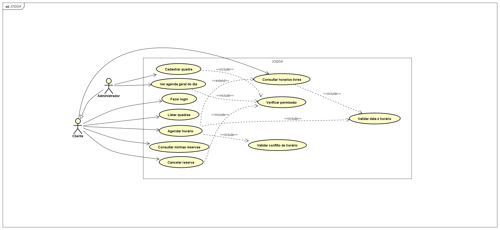
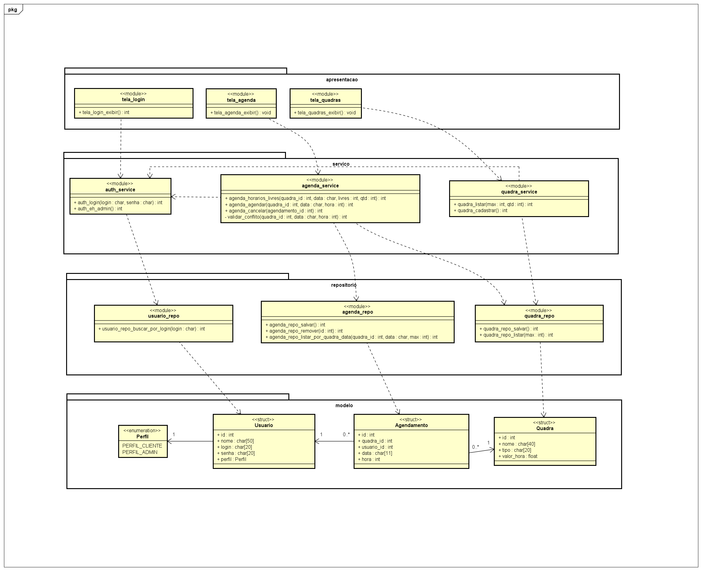

# JOGGA - Sistema de agendamento de quadras

Aplicação em **linguagem C** (modo console) que permite reservar quadras esportivas por data e horário, com controle de usuários (**cliente** e **administrador**). Desenvolvida como projeto em grupo da disciplina **ESWA (PIM II - UNIP)**, com o objetivo de demonstrar, em pequena escala, como construir uma aplicação desktop organizada: **arquitetura em camadas, modularização e diagramas UML**.

## Funcionalidades

- Login com perfis de **cliente** e **administrador**
- Consulta de horários livres por quadra e data
- Agendamento e cancelamento de reservas
- Consulta das minhas reservas
- Cadastro de novas quadras e agenda geral do dia (somente administrador)
- Regra principal: **nunca existem dois agendamentos na mesma quadra, no mesmo dia e horário**

Requisitos completos (RF, RNF e regras de negócio): [`docs/requisitos.md`](docs/requisitos.md)

## Arquitetura


O sistema é dividido em quatro camadas. Cada camada só conversa com a camada imediatamente abaixo.

| Camada | Pasta | Responsabilidade |
|---|---|---|
| Apresentação | `src/apresentacao` | Menus e telas no terminal (`printf`/`fgets`); só chamam os serviços |
| Serviço | `src/servico` | Regras de negócio (ex.: conflito de horário, permissões, validação de data) |
| Repositório | `src/repositorio` | Leitura e gravação dos arquivos binários (`fopen`/`fread`/`fwrite`) |
| Modelo | `src/modelo` | Structs de dados (`Usuario`, `Quadra`, `Agendamento`) |

Além das camadas, o código é **modularizado por funcionalidade**: módulo de usuários (login), módulo de agendamentos e módulo de quadras. Cada módulo possui a sua tela, o seu serviço, o seu repositório e o seu modelo, sempre em pares `.h` (interface pública) e `.c` (implementação). Funções `static` são privadas do módulo.

| Módulo | Apresentação | Serviço | Repositório | Modelo |
|---|---|---|---|---|
| Usuários | `tela_login` | `auth_service` | `usuario_repo` | `usuario.h` |
| Agendamentos | `tela_agenda` | `agenda_service` | `agenda_repo` | `agendamento.h` |
| Quadras | `tela_quadras` | `quadra_service` | `quadra_repo` | `quadra.h` |

Explicação detalhada: [`docs/arquitetura.md`](docs/arquitetura.md)

## Diagramas UML

### Casos de uso



O **cliente** consulta horários, agenda, consulta e cancela as próprias reservas. O **administrador** herda tudo do cliente e ainda cadastra quadras e acompanha a agenda geral. *Agendar horário* inclui os casos de uso **Validar conflito de horário** e **Validar data e horário**.

### Classes (módulos e rotinas, por camada)

Em C não existem classes: cada **módulo** (`.c` + `.h`) é representado como uma classe com o estereótipo `<<módulo>>`, e suas **rotinas** (funções) aparecem como métodos. As structs aparecem com o estereótipo `<<struct>>`. `+` = função pública (declarada no `.h`), `-` = função `static` (privada).



### Sequência - Agendar horário (opcional)


### Atividade - Agendar horário (opcional)


Os arquivos-fonte dos diagramas (PlantUML) estão em [`docs/fontes`](docs/fontes). Para editar, cole o conteúdo em <https://www.plantuml.com/plantuml> e exporte o PNG.

## Estrutura de pastas

```
jogga/
├── main.c                   # inicializa os dados e abre a aplicação
├── Makefile                 # make / make run / make test
├── README.md
├── docs/                    # diagramas, requisitos, arquitetura e roteiro da apresentação
│   └── fontes/              # código-fonte PlantUML dos diagramas
├── src/
│   ├── apresentacao/        # app, console, tela_login, tela_agenda, tela_quadras (.c/.h)
│   ├── servico/             # auth_service, agenda_service, quadra_service, erros (.c/.h)
│   ├── repositorio/         # banco, usuario_repo, agenda_repo, quadra_repo (.c/.h)
│   └── modelo/              # usuario.h, quadra.h, agendamento.h
└── tests/                   # testes automatizados das regras de negócio
```

## Como executar

Requisitos: compilador **GCC** (no macOS: `xcode-select --install`; no Windows: MinGW ou o GCC do Code::Blocks/Dev-C++).

**macOS / Linux**

```
make run
```

**Windows (sem make)**

```
gcc -Wall -std=c99 -o jogga.exe main.c src/repositorio/*.c src/servico/*.c src/apresentacao/*.c
jogga.exe
```

Na primeira execução a pasta `dados/` é criada automaticamente, com dados de exemplo (3 quadras e 2 usuários).

| Perfil | Login | Senha |
|---|---|---|
| Cliente | `cliente` | `cliente123` |
| Administrador | `admin` | `admin123` |

## Testes

22 testes automatizados das regras de negócio (camada de serviço):

```
make test
```

Windows: `gcc -std=c99 -o tests/test_servicos.exe tests/test_servicos.c src/repositorio/*.c src/servico/*.c` e depois `tests\test_servicos.exe`.

## Equipe

| Integrante | Responsabilidade |
|---|---|
| *RAFAEL* | Modelo e banco de dados (`src/modelo`, `banco.c`) |
| *JOAO* | Repositórios (`src/repositorio`) |
| *ROMERO* | Serviços e regras de negócio (`src/servico`, `tests`) |
| *CAUE* | Telas (`src/apresentacao`, `main.c`) |
| *DUDA* | Documentação e diagramas (`docs`) |

Disciplina: ESWA - UNIP
