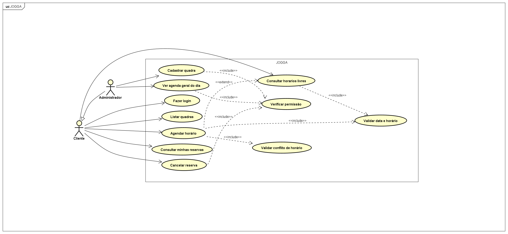
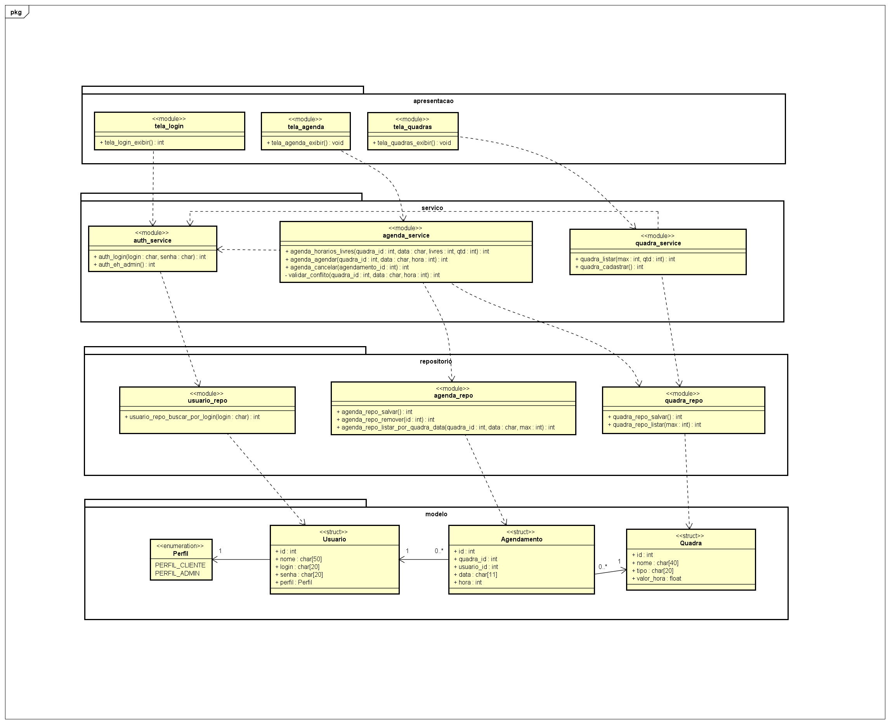
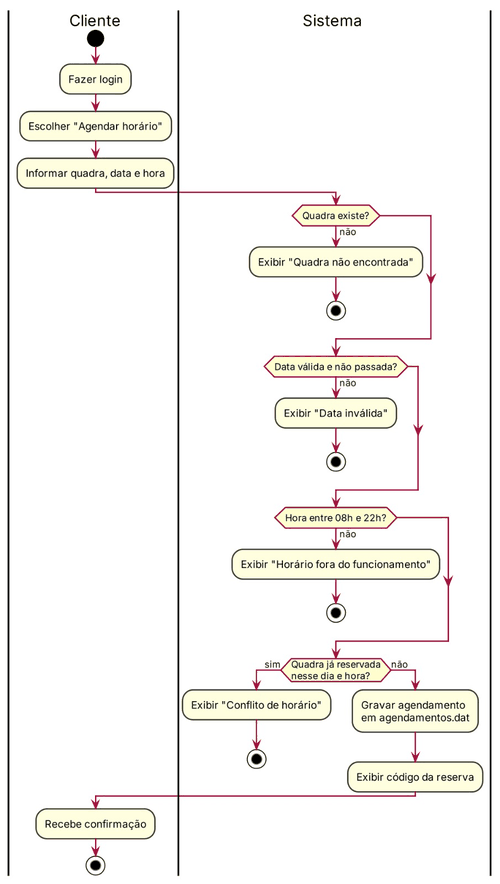
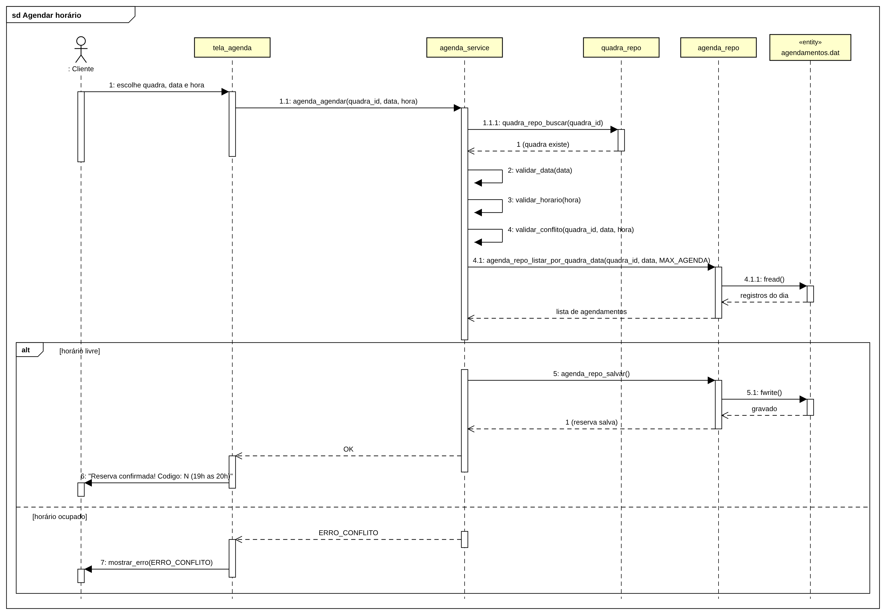

# JOGGA - Sistema de agendamento de quadras

Aplicação em **linguagem C** (modo console) que permite reservar quadras esportivas por data e horário, com controle de usuários (**cliente** e **administrador**). Desenvolvida como projeto em grupo do **PIM II (CST em Análise e Desenvolvimento de Sistemas - UNIP)**, também apresentado na disciplina ESWA, com o objetivo de demonstrar, em pequena escala, como construir uma aplicação desktop organizada: **arquitetura em camadas, modularização e diagramas UML**.

## Funcionalidades

- Login com perfis de **cliente** e **administrador**
- Consulta de horários livres por quadra e data
- Agendamento e cancelamento de reservas
- Consulta das minhas reservas
- Cadastro de novas quadras e agenda geral do dia (somente administrador)
- Regra principal: **nunca existem dois agendamentos na mesma quadra, no mesmo dia e horário**

Requisitos completos (RF, RNF e regras de negócio): [`Requisitos_JOGGA.png`](Requisitos_JOGGA.png)

## Arquitetura

O sistema é dividido em quatro camadas. Cada camada só conversa com a camada imediatamente abaixo.

Todo o código está em um **único arquivo, `jogga.c`**. As camadas são formadas por **grupos de funções**, identificados pelo nome:

| Camada | Funções | Responsabilidade |
|---|---|---|
| Apresentação | começam com `tela_` ou `ler_` | Menus e telas no terminal (`printf`/`fgets`); só chamam os serviços |
| Serviço | começam com `auth_`, `quadra_` e `agenda_` | Regras de negócio (ex.: conflito de horário, permissões, validação de data) |
| Repositório | contêm `_repo_` | Leitura e gravação dos arquivos binários (`fopen`/`fread`/`fwrite`) |
| Modelo | structs | Estruturas de dados (`Usuario`, `Quadra`, `Agendamento`) |

Além das camadas, o código é **modularizado por funcionalidade**: módulo de usuários (login), módulo de agendamentos e módulo de quadras. Cada módulo possui a sua tela, o seu serviço, o seu repositório e o seu modelo. Funções `static` são de uso interno (por exemplo, `validar_conflito`).

| Módulo | Apresentação | Serviço | Repositório | Modelo |
|---|---|---|---|---|
| Usuários | `tela_login_exibir` | `auth_login`, `auth_eh_admin` | `usuario_repo_*` | `Usuario` |
| Agendamentos | `tela_agenda_exibir` | `agenda_agendar`, `agenda_cancelar`... | `agenda_repo_*` | `Agendamento` |
| Quadras | `tela_quadras_exibir` | `quadra_listar`, `quadra_cadastrar` | `quadra_repo_*` | `Quadra` |

## Diagramas UML

### Casos de uso



O **cliente** consulta horários, agenda, consulta e cancela as próprias reservas. O **administrador** herda tudo do cliente e ainda cadastra quadras e acompanha a agenda geral. *Agendar horário* inclui os casos de uso **Validar conflito de horário** e **Validar data e horário**.

### Classes (módulos e rotinas, por camada)

Em C não existem classes: cada **grupo de funções** do `jogga.c` é representado como uma classe com o estereótipo `<<module>>`, e suas funções aparecem como operações. Os pacotes correspondem às quatro camadas. As structs aparecem com o estereótipo `<<struct>>`. `+` = função pública, `-` = função `static` (uso interno, como `validar_conflito`).



### Diagrama de Atividades – Agendar horário

<p align="center">
  
</p>

O diagrama de atividades mostra o fluxo do caso de uso **Agendar horário**, dividido em duas raias: **Cliente** e **Sistema**.

O cliente faz login, escolhe a opção "Agendar horário" e informa a quadra, a data e a hora desejadas. A partir daí, o sistema faz quatro validações em sequência. Se qualquer uma delas falhar, o fluxo é encerrado com uma mensagem de erro:

1. **A quadra existe?** Se não existir, exibe "Quadra não encontrada".
2. **A data é válida e não está no passado?** Se não for, exibe "Data inválida".
3. **A hora está entre 08h e 22h?** Se não estiver, exibe "Horário fora do funcionamento".
4. **A quadra já está reservada nesse dia e hora?** Se estiver, exibe "Conflito de horário".

Se todas as validações passarem, o sistema grava o agendamento no arquivo `agendamentos.dat` e exibe o código da reserva, e o cliente recebe a confirmação.

### Diagrama de Sequência – Agendar horário

<p align="center">
  
</p>

O diagrama de sequência mostra como o caso de uso **Agendar horário** passa pelas camadas do sistema: tela → serviço → repositório → arquivo.

**Participantes:**

| Participante | Camada | Papel |
|---|---|---|
| Cliente | — | Usuário que faz a reserva |
| `tela_agenda` | Apresentação | Recebe os dados e mostra o resultado |
| `agenda_agendar` | Serviço | Aplica as regras de negócio e as validações |
| `quadra_repo` | Repositório | Consulta as quadras cadastradas |
| `agenda_repo` | Repositório | Lê e grava os agendamentos |
| `agendamentos.dat` | Dados | Arquivo binário onde as reservas ficam salvas |

**Fluxo:**

1. O cliente escolhe a quadra, a data e a hora na `tela_agenda`, que chama `agenda_agendar(quadra_id, data, hora)` na camada de serviço.
2. O serviço confirma que a quadra existe com `quadra_repo_buscar(quadra_id)`.
3. Em seguida, valida a data (`validar_data`) e o horário de funcionamento (`validar_horario`).
4. Para verificar conflito (`validar_conflito`), o serviço pede ao `agenda_repo` as reservas daquela quadra no dia (`agenda_repo_listar_por_quadra_data`), e o repositório lê os registros do arquivo com `fread()`.
5. O resultado depende da disponibilidade:
   - **Horário livre:** o serviço chama `agenda_repo_salvar()`, que grava a reserva no `agendamentos.dat` com `fwrite()`. A tela exibe "Reserva confirmada!" com o código da reserva.
   - **Horário ocupado:** o serviço retorna `ERRO_CONFLITO` e a tela exibe a mensagem de `erro_mensagem(ERRO_CONFLITO)` para avisar o cliente.

Esse fluxo segue a arquitetura em camadas do projeto: a tela nunca acessa o arquivo diretamente, e toda regra de negócio fica concentrada na camada de serviço.

O arquivo-fonte dos diagramas está em `Digrama de Classes jogga.asta` (Astah).

## Estrutura do repositório

```
JOGGA-/
├── jogga.c                         # código-fonte completo (4 camadas em um único arquivo)
├── jogga.sql                       # script do banco de dados relacional (SQL Server)
├── Requisitos_JOGGA.docx           # requisitos funcionais, não funcionais e regras de negócio
├── Digrama de Classes jogga.asta   # projeto dos diagramas UML (Astah)
├── DiagramadeCasosdeUso.png
├── DiagramadeClasses.png
├── DiagramadeAtividade.png
├── DiagramadeSequencia.png
└── README.md
```

O protótipo em C guarda os dados em arquivos binários. O `jogga.sql` traz o banco de dados relacional modelado para a versão on-line do sistema.

## Como executar

O programa foi desenvolvido e testado no **Code::Blocks**, com o compilador **GCC**.

**Code::Blocks:** abra o `jogga.c` e use *Build and run* (F9).

**Linha de comando (Windows, Linux ou macOS):**

```
gcc -Wall -std=c99 -o jogga jogga.c
./jogga
```

No Windows, execute `jogga.exe`.

Na primeira execução a pasta `dados/` é criada automaticamente, com dados de exemplo (3 quadras e 2 usuários) nos arquivos `usuarios.dat`, `quadras.dat` e `agendamentos.dat`.

| Perfil | Login | Senha |
|---|---|---|
| Cliente | `cliente` | `cliente123` |
| Administrador | `admin` | `admin123` |

## Testes

A verificação das regras foi feita manualmente, executando os cenários de cada regra de negócio. Por exemplo: tentar reservar duas vezes o mesmo horário e tentar cancelar a reserva de outro usuário.

## Equipe

O projeto foi conduzido pelo squad **DevTeam**, com papéis do Scrum.

| Integrante | Papel | Responsabilidade |
|---|---|---|
| *CAUE SILVA* | Product Owner | Backlog e validação das entregas; camada de apresentação (telas e menus) |
| *JOAO PEDRO ROMERO* | Scrum Master | Eventos do Scrum; camada de serviço e regras de negócio |
| *RAFAEL ALVES ROSA* | Desenvolvedor | Camada de modelo e banco de dados |
| *JOAO PEDRO CARVALHO* | Desenvolvedor | Camada de repositório (persistência em arquivos) e repositório no GitHub |
| *MARIA EDUARDA CURSINO* | Desenvolvedora | Documentação e diagramas UML |
| *CAUA CORREA* | Desenvolvedor | Documentação e diagramas UML |

PIM II - UNIP | Equipe DevTeam
